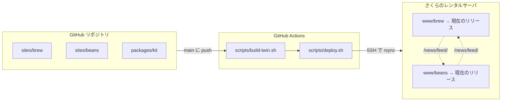

# astro-twin-sites

[English](README.md) | 日本語

2つの Astro 静的サイトが互いの新着情報を表示し合う「双子サイト」のデモです。サイト内検索、絞り込み、レンタルサーバへの CI/CD デプロイを備えています。

## 特徴

- **Astro による静的サイト。** 出力は素の HTML/CSS/JS で、サーバ側の実行環境を必要としません。
- **双子サイトと相互ヘッドライン。** 各サイトのトップページに相手サイトの最新ニュースを表示します。相手の RSS フィードを**ビルド時に**読み込みます。
- **CI/CD。** GitHub Actions が両サイトをビルドし、SSH でさくらのレンタルサーバにデプロイします。
- **アトミックなリリースとロールバック。** デプロイのたびに新しいリリースディレクトリへアップロードし、公開中のリリースはシンボリックリンク1つの差し替えで切り替えます。
- **プレビュー環境。** 同じコミットを、サーバの初期ドメインのサブディレクトリにも検索エンジン除け付きで同時にデプロイします。
- **全文検索。** [Pagefind](https://pagefind.app/) がブラウザ側で動き、日本語と英語で別々のインデックスを持ちます。
- **階層構造のコンテンツ。** 豆カタログでは、豆（親）ごとに子となる記事（カッピングログ、レシピ、レビュー、ユーザーの声）がぶら下がります。豆のページには記事の種類ごとのページを並べたサイドバーがあり、ファインダーでは「どの種類の記事がある豆か」でも絞り込めます。親子のリンクはビルド時に解決・検証されます。
- **メタデータによる絞り込み。** カテゴリ、産地、精製方法、焙煎度などのメタデータで一覧を絞り込め、複数の観点を組み合わせられます。絞り込みの状態は URL に入るので、絞り込んだ一覧をリンクとして共有できます。
- **日英2言語。** 翻訳は項目ごとに対になっています。日本語だけの項目も破綻なく扱え、各ページに hreflang の代替リンクがあります。
- **RSS フィードとサイトマップ。** 各サイトに言語別の RSS 2.0 フィードとサイトマップがあります。
- **Markdown によるコンテンツ。** ニュース、カフェ、豆はどれもフロントマター付きの Markdown ファイルで、ビルド時に Zod スキーマで検証されます。
- **コードの共有。** npm workspaces で、2つのサイトと小さな共有キット（多言語処理、翻訳の対、相手サイトのフィードを読むローダー）をまとめています。

カフェガイドを除き、内容はすべて架空です（「免責事項」を参照）。

| サイト | URL | 内容 |
|------|-----|------------|
| **Brew Tsukuba**（`sites/brew`） | `https://<brew-domain>/` | つくばのカフェとコーヒーの話題：ニュース、カフェガイド、固定ページ |
| **BeanDaCs**（`sites/beans`） | `https://<beans-domain>/`（brew ドメインのサブドメイン） | ブラウザ側でメタデータ絞り込みができるコーヒー豆のデータカタログ |



## 技術構成

- [Astro](https://astro.build/) 7、`output: "static"`、`trailingSlash: "always"`、strict な TypeScript
- Content Collections（glob ローダー）と Zod スキーマ。項目と言語ごとに Markdown ファイル1つ
- [`@astrojs/rss`](https://docs.astro.build/en/recipes/rss/) で `/news/feed/` と `/en/news/feed/` を生成
- [`@astrojs/sitemap`](https://docs.astro.build/en/guides/integrations-guide/sitemap/) で hreflang 付きのサイトマップを生成
- [Pagefind](https://pagefind.app/) によるブラウザ側の全文検索（日英で別インデックス）
- npm workspaces：`sites/brew`、`sites/beans`、`packages/kit`（共有ヘルパー）

## 開発

Node 22.23.4 以降が必要です（CI は `.nvmrc` のバージョンを使います）。

```bash
npm install
npm run dev:brew      # http://localhost:4321/
npm run dev:beans     # http://localhost:4322/
```

開発中は、各サイトが相手のヘッドラインを公開中のサイトから取得します。取得先は `SIBLING_FEED_SOURCE` で変えられます。値はベース URL、相手サイトのローカルの `dist/` ディレクトリ、または空文字列（セクションを省略）です。

```bash
SIBLING_FEED_SOURCE=http://localhost:4322/ npm run dev:brew
```

検索は本番ビルドでしか動きません。Pagefind が `dist/` からインデックスを作るためです。

```bash
npm run build         # 両サイトをビルド（「相互ヘッドライン」を参照）
npm run preview:brew
npm run preview:beans
```

## コンテンツ

各項目は1つのフォルダで、そのフォルダが翻訳の対になります。

```
sites/brew/src/content/news/2026/2026-10-01-some-topic/
  index.ja.md   ← 正本：すべてのメタデータ（slug、date、category など）＋日本語本文
  index.en.md   ← 任意：翻訳する項目だけ（title、summary、本文）
```

- **メタデータは日本語ファイルが持ちます。** 英語ファイルはそれを引き継ぎ、自分で書いた項目だけを上書きします。言語に依存しない項目を手作業で揃える必要はありません。日本語ファイルに必須項目が欠けているとビルドが失敗します。
- **`index.en.md` のない項目は日本語だけに存在します。** 英語のページには現れず、その項目の言語切り替えリンクは英語の一覧ページを指します。
- **URL はフォルダ名ではなくフロントマターの `slug` から決まります。** フォルダ名を変えても URL は変わりません。
- **日本語ファイルに `draft: true` を書くと、両言語とも非公開になります。**
- **カテゴリはコードでフロントマターに書きます。** 各言語での表示名と表示順は、各サイトの `src/lib/labels.ts` にあります。

### Brew Tsukuba

| URL（日 / 英） | ページ |
|---|---|
| `/` · `/en/` | トップ：最新ニュース、カフェガイドのおすすめ、**BeanDaCs のヘッドライン** |
| `/news/` · `/news/<slug>/` | ニュース一覧（カテゴリ絞り込み）と記事 |
| `/news/feed/` · `/en/news/feed/` | RSS 2.0 |
| `/cafes/` · `/cafes/<slug>/` | カフェガイド（カテゴリ絞り込み） |
| `/about/`、`/contact/`、`/site-policy/`、`/search/` | 固定ページ、Pagefind 検索 |

### BeanDaCs

| URL（日 / 英） | ページ |
|---|---|
| `/` · `/en/` | トップ：種別から探す、スタッフのおすすめ、最新の記事、お知らせ、**Brew Tsukuba のヘッドライン** |
| `/find/` | ファインダー：種別、産地（地域 › 国）、精製方法、焙煎度、販売状況、スタッフのおすすめ、頭文字で絞り込み、名前・新しい順・焙煎度で並べ替え。どの種類の記事がある豆かでも絞り込めます。状態はクエリ文字列に保存されます（`/find/?type=blend&country=ET`）。 |
| `/beans/<slug>/` · `/beans/<slug>/<kind>/` | 豆の詳細。サイドバーのメニューは、基本情報（メタデータの値はすべてファインダーへのリンク）と、記事の種類ごとのページです。記事のない種類はグレー表示になります。 |
| `/notes/` · `/notes/<slug>/` | 豆の記事：カッピングログ、レシピ、レビュー、ユーザーの声。どれも1つ以上の豆に結び付いています |
| `/news/` · `/news/<slug>/` · `/news/feed/` | お知らせと RSS |
| `/about/`、`/contact/`、`/site-policy/`、`/search/` | 固定ページ、Pagefind 検索 |

#### 豆と記事

カタログは2階層です。**豆**がカタログの項目で、**記事**がその下にぶら下がります。

```
豆     src/content/beans/<slug>/       →  /beans/<slug>/              （基本情報）
 └─ 記事   src/content/notes/<slug>/  →  /beans/<slug>/cupping-log/  （種類ごとに1ページ：
                                          /beans/<slug>/recipe/        cupping-log、recipe、
                                          /beans/<slug>/review/        review、voice）
                                          /beans/<slug>/voice/
                                       →  /notes/<slug>/              （記事ごと）
```

- **リンクは上向きだけです。** 子が親を指します。記事がフロントマターで豆を slug で指定します（`beans: [red-ridge-nyeri]`）。豆の側は記事を列挙しないので、記事を追加しても触るファイルは1つで済みます。
- **1つの記事が複数の豆に属せます。** 比較カッピングなどです。その記事のページには最初に指定した豆のサイドバーが表示され、ほかの豆は本文の下に並びます。
- **リンク切れはビルドを失敗させます。** 存在しない slug があるとビルドが止まります。
- **それ以外はすべてビルド時に導出します。** 種類ごとのページ、サイドバーの件数とグレー表示、カードごとの記事数、ファインダーの「記事のある豆」の絞り込みが該当します。この絞り込み用の情報は各カードに埋め込まれているので、絞り込み時に何かを問い合わせることはありません。

豆のメタデータは、日本語ファイルにコードで書きます（例：`type: blend`、`country: [ET, CO]`、`process: washed`）。ファインダーは、事前に生成されたカードの `data-*` 属性を使ってブラウザ内だけで動きます。同じ観点の中でチェックした値は OR、観点どうしは AND で組み合わせます。

## 相互ヘッドライン

`packages/kit/src/sibling-feed.ts` はコンテンツレイヤーのローダーです。サイトのビルド中に相手の `/news/feed/` と `/en/news/feed/` を読み、項目を `siblingNews` コレクションに格納します。フィードに届かない場合は警告を出すだけで、セクションは空になり、ビルドは失敗しません。

2つのサイトを、互いの*公開中の*フィードを読みながら順にビルドすると、先にビルドした方のヘッドラインは常にデプロイ1回分古くなります。`npm run build`（`scripts/build-twin.sh`）は、3回ビルドしてこれを避けます。

1. **brew** を相手のヘッドラインなしでビルド。brew の最新フィードを作るためだけのビルドです。
2. **beans** をビルド。brew のフィードを `sites/brew/dist` から読みます。
3. **brew** を再ビルド。beans のフィードを `sites/beans/dist` から読みます。

これで、1回の実行で両サイトが互いの最新ニュースを表示します。

## デプロイ

`.github/workflows/deploy.yml` は `main` への push のたびに、また Actions タブから手動でも実行されます。matrix により、同じ手順を2つの配信先で並行して実行します。

| 配信先 | URL | サーバ上のディレクトリ |
|---|---|---|
| `production` | `https://<brew-domain>/`、`https://<beans-domain>/` | `www/brew`、`www/beans` |
| `preview` | `<PREVIEW_ORIGIN>/brew_preview/`、`<PREVIEW_ORIGIN>/beans_preview/` | `www/brew_preview`、`www/beans_preview` |

各配信先で次の手順を実行します。

1. **ビルド。** 配信先のサイト URL で `npm ci && npm run build`（「サイト URL」を参照）。
2. **デプロイ。** `scripts/deploy.sh beans`、続いて `scripts/deploy.sh brew`。デプロイ専用の鍵と、固定したホスト鍵を使って SSH で接続します。
3. **スモークテスト。** 両サイトのトップページとフィードを `curl` で確認します。プレビューでは `X-Robots-Tag: noindex` ヘッダーも確認します。

プレビューは、同じコミットをサーバの初期ドメインのサブディレクトリで配信するもので、検索エンジンには載りません（`NOINDEX`）。デプロイ用のシークレットが未設定なら、ビルドだけ行い、デプロイは警告付きで飛ばします。`PREVIEW_ORIGIN` が未設定の場合、プレビューも同様です。

### アトミックなリリース

パスはサーバのホームディレクトリからの相対です。

```
deploy/<site>/releases/20261029T083441Z-1a2b3c4/   デプロイごとの完全なアップロード
deploy/<site>/current -> releases/<id>             アップロード成功後にだけ付け替え
www/<site> -> ../deploy/<site>/current             ドメインの公開フォルダー
```

**アップロード。** rsync は、まだどこからも配信されていない新しいリリースディレクトリに書き込みます。変更のないファイルは公開中のリリースからハードリンクするので、転送されるのは差分だけです。

**切り替え。** 続いてシンボリックリンクのリネームで `current` を差し替えます。この操作はアトミックです。ビルドやアップロードが失敗しても、公開中のサイトには影響しません。

**保持数。** 直近5つのリリースを残します。

**初回デプロイ。** スクリプトが `www/<site>` のシンボリックリンクを作ります。コントロールパネルがすでに実フォルダーを作っていた場合は、それを `deploy/<site>/docroot-before-symlink.*` に退避します。

**サーバが置いたファイル。** 公開中の公開フォルダーにある `.well-known/`（証明書の検証用など）は、新しいリリースにも引き継ぎます。

### ロールバック

```bash
scripts/rollback.sh brew            # リリースの一覧（公開中のものに印）
scripts/rollback.sh brew previous   # 公開中の1つ前のリリースに切り替え
scripts/rollback.sh brew 20261029T083439Z-03256b0
DEPLOY_DIR=brew_preview scripts/rollback.sh brew previous   # プレビュー
```

どちらのスクリプトも `~/.ssh/config` の `sakura` というホスト別名で接続します。`DEPLOY_REMOTE` で変更できます。

## 設定

以下で使うプレースホルダー：

| プレースホルダー | 意味 |
|---|---|
| `<brew-domain>` / `<beans-domain>` | 2つのサイトの公開ホスト名。`packages/kit/src/sites.ts` の既定値です（「サイト URL」を参照）。 |
| `<server-host>` | レンタルサーバの SSH ホスト名 |
| `<server-user>` | レンタルサーバの SSH ユーザー。そのホームディレクトリに `www/` があります |

### サイト URL

各サイトの公開 URL は、ビルド時に `BREW_URL` / `BEANS_URL` から読みます。未設定なら `packages/kit/src/sites.ts` にある本番ホストを使います。この URL から、Astro の `site`、サイト間のリンク、相手サイトのフィードの URL、`robots.txt`、スモークテストの URL が決まります。

URL にはパスを含められます。

```bash
BREW_URL=https://<initial-domain>/brew_preview/ BEANS_URL=https://<initial-domain>/beans_preview/ npm run build
```

のようにビルドすると、各サイトはそのサブディレクトリで動きます（Astro の `base`）。サイト内のリンク、Pagefind の読み込みと検索結果、`.htaccess` の `ErrorDocument` にすべて接頭辞が付きます。これにより、本物のドメインを向ける前に、新しいビルドをサーバの初期ドメインで確認できます。ルート相対の URL を書くコードは、必ず `packages/kit/src/i18n.ts` の `localize()` か `withBase()` を通してください。`"/..."` と直接書いたパスはサブディレクトリのビルドでだけ壊れるので、一度サブディレクトリのビルドで確かめてください。Markdown 本文に直接書いた絶対 URL は書き換えません。

このビルドをデプロイするときは、`DEPLOY_DIR` で各サイトにサーバ上の専用ディレクトリを与えてください（`DEPLOY_DIR=brew_preview scripts/deploy.sh brew`）。指定しないと本番の公開フォルダー `www/brew` を置き換えてしまいます。初期ドメインは `www/<dir>` を `/<dir>/` で配信するので、ディレクトリ名は URL のサブディレクトリと一致させる必要があります。あとでドメインをそのディレクトリに切り替えるときは、ディレクトリはそのままでドメインの URL で再ビルドし、そのあとコントロールパネルでドメインの公開フォルダーを変更します。

`NOINDEX=1` はビルドをプレビューとして扱います。全ページに `<meta name="robots" content="noindex, nofollow">` が付き、`.htaccess` がフィードや検索インデックスを含む全ファイルに `X-Robots-Tag: noindex, nofollow` を付けて返します。クローラーはホスト直下の `robots.txt` しか読まないので、`robots.txt` ではこれを実現できません。

CI のプレビューはこれらをすべて自分で設定します。必要なのはリポジトリ変数 `PREVIEW_ORIGIN`（サーバの初期ドメイン、例：`https://<initial-domain>`）だけです（`gh variable set PREVIEW_ORIGIN`）。

ワークフローは次の GitHub Actions シークレットを読みます。

| シークレット | 内容 |
|---|---|
| `SAKURA_HOST` | `<server-host>` |
| `SAKURA_USER` | `<server-user>` |
| `SAKURA_SSH_KEY` | デプロイ専用の鍵ペアの秘密鍵 |
| `SAKURA_KNOWN_HOSTS` | サーバの `known_hosts` の行。ホスト鍵の固定に使います |

## セットアップ手順（初回のみ）

1. **DNS。** `<brew-domain>` と `<beans-domain>` をレンタルサーバに向けます（例：`<server-host>` への CNAME）。
2. **ドメイン。** サーバのコントロールパネルで両ドメインを追加し、公開フォルダーを設定します。
   - `<brew-domain>` → `~/www/brew`
   - `<beans-domain>` → `~/www/beans`
3. **SSL。** DNS が引けるようになったら、両ドメインの証明書を有効にします。`sites/*/public/.htaccess` は HTTP を HTTPS にリダイレクトするので、証明書が有効になるまではそのルールをコメントアウトしておきます。
4. **デプロイ鍵。** 手元でデプロイ専用の鍵ペアを作り、サーバに登録します。
   ```bash
   ssh-keygen -t ed25519 -N "" -C "astro-twin-sites deploy" -f ~/.ssh/astro-twin-deploy
   ssh-copy-id -i ~/.ssh/astro-twin-deploy.pub <server-user>@<server-host>
   ```
5. **ホスト鍵。** `ssh-keyscan -t ed25519 <server-host>` でサーバのホスト鍵を記録し、保存する前に信頼できる情報源と指紋を照合します。
6. **シークレット。** 上の4つのシークレットを保存します（例：`gh secret set`）。
7. **ワークフローを実行。** `main` に push するか、Actions タブからワークフローを実行します。
8. **フィードを確認。** `curl -I https://<brew-domain>/news/feed/` を実行し、フィードがディレクトリの URL で配信されていることを確かめます。これは `.htaccess` の `DirectoryIndex index.html index.xml` に依存しています。

手元のマシンからデプロイするには、`~/.ssh/config` にホスト別名を追加してから `npm run build && scripts/deploy.sh brew` を実行します。

```
Host sakura
  HostName <server-host>
  User <server-user>
  IdentityFile ~/.ssh/astro-twin-deploy
```

環境固有の具体的な手順は `SETUP.local.md` に書きます。このファイルは git の管理対象外で、コミットされません。

## 免責事項

これは静的サイト構成の実験用デモです。ニュース（両サイトとも）と、豆の記事を含む豆カタログの内容はすべて架空のものです。Brew Tsukuba のニュースのタイトルには【架空】/ [Fictional] と付けています。カフェガイドは、つくばに実在するカフェを公開情報のみに基づいて紹介しており、各店舗とは無関係で、内容の正確性は保証しません。
