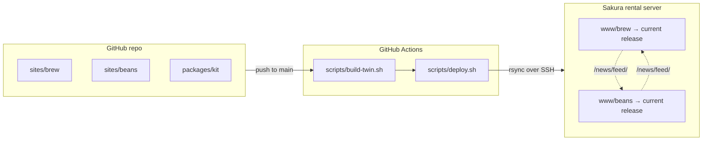

# astro-twin-sites

Demo of bilingual twin Astro static sites that share headlines, with search, filtering, and CI/CD deploys to a rental server.

## Features

- **Astro static sites.** Plain HTML/CSS/JS output with no server-side runtime.
- **Twin sites, mutual headlines.** Each site shows the other's latest news on its home page, read from the other's RSS feed **at build time**.
- **CI/CD.** GitHub Actions builds both sites and deploys them over SSH to a Sakura rental server.
- **Atomic releases with rollback.** Each deploy goes to a new release directory, and switching the live release is a single symlink swap.
- **Full-text search.** [Pagefind](https://pagefind.app/) runs client-side, with separate Japanese and English indexes.
- **Metadata filtering.** Lists can be narrowed by metadata such as category, origin, process, and roast, combined across facets. The filter state lives in the URL, so a filtered view can be shared as a link.
- **Bilingual (日本語 / English).** Translations are paired per item. An item that exists only in Japanese is handled cleanly, and each page carries hreflang alternates.
- **RSS feeds and sitemaps.** Each site has an RSS 2.0 feed per language and a sitemap.
- **Content from Markdown.** Every news item, café, and bean is a Markdown file with frontmatter, validated by a Zod schema at build time.
- **Shared code.** npm workspaces hold the two sites and a small shared kit (i18n, translation pairs, the sibling-feed loader).

All content is fictional except the café guide (see Disclaimer).

| Site | URL | What it is |
|------|-----|------------|
| **Brew Tsukuba** (`sites/brew`) | `https://<brew-domain>/` | Café topics & news from Tsukuba: news, a café guide, static pages |
| **BeanDaCs** (`sites/beans`) | `https://<beans-domain>/` (a subdomain of the brew domain) | A coffee-bean data catalog with client-side metadata filtering |



## Stack

- [Astro](https://astro.build/) 7, `output: "static"`, `trailingSlash: "always"`, strict TypeScript
- Content Collections (glob loader) with Zod schemas; one Markdown file per item and language
- [`@astrojs/rss`](https://docs.astro.build/en/recipes/rss/) for `/news/feed/` and `/en/news/feed/`
- [`@astrojs/sitemap`](https://docs.astro.build/en/guides/integrations-guide/sitemap/) with hreflang alternates
- [Pagefind](https://pagefind.app/) for client-side full-text search (separate ja / en indexes)
- npm workspaces: `sites/brew`, `sites/beans`, and `packages/kit` (shared helpers)

## Develop

Requires Node 22.23.4 or later (CI uses the version in `.nvmrc`).

```bash
npm install
npm run dev:brew      # http://localhost:4321/
npm run dev:beans     # http://localhost:4322/
```

In dev, each site fetches its twin's headlines from the live site. Point it somewhere else with `SIBLING_FEED_SOURCE`: a base URL, a local `dist/` directory of the other site, or an empty string to skip the section.

```bash
SIBLING_FEED_SOURCE=http://localhost:4322/ npm run dev:brew
```

Search only works on a production build, since Pagefind indexes `dist/`:

```bash
npm run build         # builds both sites (see "Mutual headlines")
npm run preview:brew
npm run preview:beans
```

## Content

Every item is a folder; the folder is the translation pair.

```
sites/brew/src/content/news/2026/2026-10-01-some-topic/
  index.ja.md   ← canonical: all metadata (slug, date, category, …) + Japanese text
  index.en.md   ← optional: translated fields only (title, summary, body)
```

- **The Japanese file holds the metadata.** The English file inherits it and only overrides what it sets, so language-neutral fields never have to be kept in sync by hand. A build fails if the Japanese file is missing a required field.
- **An item without `index.en.md` exists only in Japanese.** It does not appear on English pages, and the language switcher on it points to the English list page instead.
- **URLs come from the frontmatter `slug`, not the folder name.** Renaming a folder never changes a URL.
- **`draft: true` in the Japanese file hides both languages.**
- **Category codes are stored in frontmatter.** Their labels in each language, and the order they display in, live in each site's `src/lib/labels.ts`.

### Brew Tsukuba

| URL (ja / en) | Page |
|---|---|
| `/` · `/en/` | Home: latest news, café guide picks, **BeanDaCs headlines** |
| `/news/` · `/news/<slug>/` | News list (category filter) and articles |
| `/news/feed/` · `/en/news/feed/` | RSS 2.0 |
| `/cafes/` · `/cafes/<slug>/` | Café guide (category filter) |
| `/about/`, `/contact/`, `/site-policy/`, `/search/` | Static pages, Pagefind search |

### BeanDaCs

| URL (ja / en) | Page |
|---|---|
| `/` · `/en/` | Home: browse by type, staff picks, news, **Brew Tsukuba headlines** |
| `/find/` | Finder: filter by type, origin (region › country), process, roast, availability, staff pick, initial letter; sort by name / newest / roast. State is kept in the query string (`/find/?type=blend&country=ET`). |
| `/beans/<slug>/` | Bean detail; every metadata value links back into the finder |
| `/news/` · `/news/<slug>/` · `/news/feed/` | News and RSS |
| `/about/`, `/contact/`, `/site-policy/`, `/search/` | Static pages, Pagefind search |

Bean metadata lives in the Japanese file as codes, e.g. `type: blend`, `country: [ET, CO]`, `process: washed`. The finder runs entirely in the browser over `data-*` attributes on the pre-rendered cards. Within one facet, ticked values are combined with OR; across facets, with AND.

## Mutual headlines

`packages/kit/src/sibling-feed.ts` is a content-layer loader. It reads the twin's `/news/feed/` and `/en/news/feed/` while the site builds and stores the items in a `siblingNews` collection. If the feed is unreachable, the loader only logs a warning: the section renders empty and the build does not fail.

If two sites build one after the other against each other's *live* feeds, the first one always shows headlines a deploy behind. `npm run build` (`scripts/build-twin.sh`) avoids this by building three times:

1. **brew**, without sibling headlines. This build exists only to produce brew's fresh feed.
2. **beans**, reading brew's feed from `sites/brew/dist`.
3. **brew** again, reading beans' feed from `sites/beans/dist`.

The result is that both sites show each other's current news in a single run.

## Deploy

`.github/workflows/deploy.yml` runs on every push to `main`, and on demand from the Actions tab:

1. **Build.** `npm ci && npm run build`.
2. **Deploy.** `scripts/deploy.sh beans`, then `scripts/deploy.sh brew`, over SSH with a dedicated key and a pinned host key.
3. **Smoke-test.** `curl` both home pages and both feeds.

If the deploy secrets are not set, the workflow builds and then skips the deploy with a warning.

### Atomic releases

Paths are relative to the server's home directory.

```
deploy/<site>/releases/20261029T083441Z-1a2b3c4/   one complete upload per deploy
deploy/<site>/current -> releases/<id>             repointed only after the upload succeeds
www/<site> -> ../deploy/<site>/current             the domain's document root
```

**Upload.** rsync writes into a new release directory that nothing serves yet. Files that haven't changed are hard-linked from the live release, so each deploy only transfers the diff.

**Switch.** `current` is then swapped by renaming a symlink, which is atomic. A failed build or upload leaves the live site untouched.

**Retention.** The last 5 releases are kept.

**First deploy.** The script creates the `www/<site>` symlink. If the control panel has already created a real folder there, the script moves it aside to `deploy/<site>/docroot-before-symlink.*`.

**Server-placed files.** `.well-known/` in the live docroot, e.g. for certificate validation, is carried over into each new release.

### Rollback

```bash
scripts/rollback.sh brew            # list releases, marking the live one
scripts/rollback.sh brew previous   # switch to the release before the live one
scripts/rollback.sh brew 20261029T083439Z-03256b0
```

Both scripts connect to the `sakura` host alias from `~/.ssh/config`; override it with `DEPLOY_REMOTE`.

## Configuration

Placeholders used below:

| Placeholder | Meaning |
|---|---|
| `<brew-domain>` / `<beans-domain>` | Public hostnames of the two sites. They are set as `site` in `sites/*/astro.config.mjs`, and as the sibling feed URL in `sites/*/src/content.config.ts`. |
| `<server-host>` | SSH hostname of the rental server |
| `<server-user>` | SSH user on the rental server, whose home directory holds `www/` |

The workflow reads these GitHub Actions secrets:

| Secret | Content |
|---|---|
| `SAKURA_HOST` | `<server-host>` |
| `SAKURA_USER` | `<server-user>` |
| `SAKURA_SSH_KEY` | Private half of a key pair used only for deploys |
| `SAKURA_KNOWN_HOSTS` | The server's `known_hosts` line, used to pin its host key |

## Setup checklist (one-time)

1. **DNS.** Point `<brew-domain>` and `<beans-domain>` at the rental server, e.g. with a CNAME to `<server-host>`.
2. **Domains.** In the server's control panel, add both domains and set their public folders:
   - `<brew-domain>` → `~/www/brew`
   - `<beans-domain>` → `~/www/beans`
3. **SSL.** Enable a certificate for both domains once DNS resolves. `sites/*/public/.htaccess` redirects HTTP to HTTPS, so comment that rule out until the certificates are active.
4. **Deploy key.** Generate a dedicated key pair locally and authorize it on the server:
   ```bash
   ssh-keygen -t ed25519 -N "" -C "astro-twin-sites deploy" -f ~/.ssh/astro-twin-deploy
   ssh-copy-id -i ~/.ssh/astro-twin-deploy.pub <server-user>@<server-host>
   ```
5. **Host key.** Record the server's host key with `ssh-keyscan -t ed25519 <server-host>`, and check its fingerprint against a trusted source before you store it.
6. **Secrets.** Store the four secrets above, e.g. with `gh secret set`.
7. **Run the workflow.** Push to `main`, or run the workflow from the Actions tab.
8. **Check the feeds.** Run `curl -I https://<brew-domain>/news/feed/` and confirm the feed is served at its directory URL. This relies on `DirectoryIndex index.html index.xml` in `.htaccess`.

To deploy from your own machine, add the alias to `~/.ssh/config`, then run `npm run build && scripts/deploy.sh brew`:

```
Host sakura
  HostName <server-host>
  User <server-user>
  IdentityFile ~/.ssh/astro-twin-deploy
```

Concrete, environment-specific steps belong in `SETUP.local.md`. That file is git-ignored and never committed.

## Disclaimer

This is a demo for a static-site experiment. All news items (on both sites) and everything in the bean catalog are fictional; Brew Tsukuba's news titles are marked 【架空】 / [Fictional]. The café guide introduces real Tsukuba cafés from publicly available information only, with no affiliation and no guarantee of accuracy.
